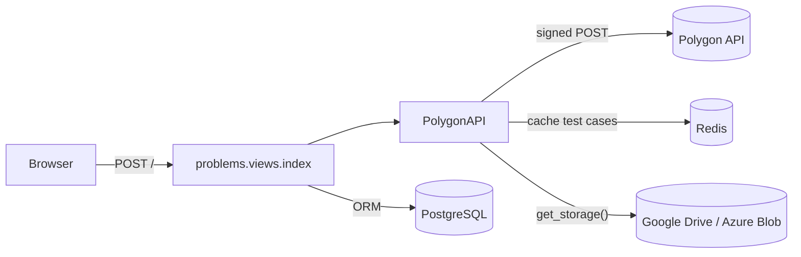

# Polygon Migration Tool – Functionality Documentation

This document follows each user action from the browser through the backend to the database, Redis, Polygon and cloud storage. File paths are relative to `PolygonMigration/`.

## 1. Architecture at a glance

| Layer | Where | Notes |
|---|---|---|
| URLs | `PolygonMigration/urls.py`, `problems/urls.py`, `users/urls.py` | `/` → `problems.views.index`, `/users/login/`, `/users/logout/`, `/admin/` |
| Single migration view | `problems/views.py` → `index()` | One endpoint handles **fetch** and all **three migrations**. Hidden form fields select the action. |
| Polygon client and orchestration | `problems/polygon_api.py` → `PolygonAPI` | Signs and sends Polygon requests, downloads packages, caches test cases in Redis, compiles custom checkers, runs the storage migration |
| Storage abstraction | `problems/storage/` | `StorageBackend` interface; `GoogleDriveStorage` and `AzureBlobStorage` implementations; `get_storage()` factory selected by `STORAGE_PROVIDER` |
| Auth | `users/views.py`, `users/backends.py`, `users/models.py` | Email-based custom `User`; only `is_staff` users may log in |
| Models | `problems/models.py` | `Problem`, `ProblemTag`, `SampleTestCase`, `ProblemTestCase` |
| UI | `problems/templates/problems/index.html`, `users/templates/users/login.html` | Server-rendered Django templates, Bootstrap, vanilla JS |

Every action in the main UI is a **full-page `POST /`** to `index()`. The view always re-runs the whole fetch pipeline (§3) so it can re-render the page. A migration request therefore does all the work of a fetch plus the migration-specific work.



---

## 2. Flow: User login

**What the user does:** opens `/users/login/` (or is redirected there by `index()`), enters an email and password, and clicks **Login**.

**What the frontend sends:** `POST /users/login/` (form-encoded) with `csrfmiddlewaretoken`, `email` and `password`.

**What the backend does, in order** (`users/views.py` → `login_view`):
1. If the request already has an authenticated user, it calls `logout(request)`. This happens on GET too, so just opening the login page ends the current session.
2. Reads `email` and `password` from `request.POST`.
3. Calls `authenticate(request, username=email, email=email, password=password)`. Backends are tried in the order given in `settings.AUTHENTICATION_BACKENDS`:
   - `users.backends.EmailBackend.authenticate` runs `User.objects.get(email=email)`, then `check_password()` and `user_can_authenticate()` (which checks `is_active`).
   - If that fails, Django's `ModelBackend` runs. `USERNAME_FIELD = 'email'`, so it also looks the user up by email.
4. If authentication succeeds and `user.is_staff` is true, it calls `login(request, user)` and redirects to `problems:index` (`/`).
5. Otherwise it adds a `messages.error` ("Invalid email or password." or "You do not have staff access.") and re-renders the login page.

**External APIs:** none.

**DB reads/writes:**
- Reads `users_user`.
- `login()` writes a row to `django_session` and updates `users_user.last_login`.
- The session cookie lasts 1 day (`SESSION_COOKIE_AGE = 86400`).

**What the user sees:**
- On success, the "Hatsu: Problem Migrator" page with a single Polygon Problem ID input.
- On failure, the login form with a red alert.

**Access control on `/`:** `index()` is decorated with `@user_passes_test(lambda u: u.is_authenticated and u.is_staff, login_url='/users/login/')`. **Logout** is `POST /users/logout/` → `logout_view`, which redirects to `login`.

**Creating the first user:** `python manage.py createsuperuser` prompts for every field in `User.REQUIRED_FIELDS`: first/last name, username, contact number, college, graduation year and gender. `create_superuser` sets `is_staff=True`.

---

## 3. Flow: Fetching a problem from Polygon

**What the user does:** types a Polygon problem ID (numeric, e.g. `123456`) into the input in `index.html` (`#fetchForm`) and clicks **Fetch Problem**. JavaScript shows a loading overlay ("may take 3-4 minutes") and submits the form.

**What the frontend sends:** `POST /` with `csrfmiddlewaretoken` and `problem_id`. No action flag is sent.

**What the backend does, in order** (`problems/views.py` → `index()`):
1. Loads all `ProblemTag` rows and serialises them to JSON for the tag picker.
2. Creates `PolygonAPI()`, which reads `POLYGON_API_KEY` and `POLYGON_API_SECRET` from settings.
3. Looks up `Problem.objects.filter(polygon_id=...)`. **If the problem is already in the DB:**
   - Pre-fills difficulty and tags from the DB row.
   - Calls `problem.updateWorkingCopy`, then `problem.solutions`.
   - Picks the solution tagged `MA` (or the first solution) and downloads it with `problem.viewSolution`. This is the "Main Correct Solution" block.
4. Opens `transaction.atomic()`, then:
   1. `api.get_problem_info()` calls `problem.info` to get the time limit, memory limit and other info.
   2. `api.download_and_extract_package()`:
      - Calls `problem.info` again, then `problem.packages`.
      - Picks the newest `standard` package in state `READY`.
      - Downloads it with `problem.package` as a ZIP into a temp dir and extracts it.
      - Returns the contents of `problem.html`.
   3. `parse_problem_html()` uses lxml to extract the title and the `legend`, `input-specification`, `output-specification` and `note` divs.
   4. `api.get_all_test_cases()`:
      - Calls `problem.tests` (testset `tests`).
      - For **every** test, calls `problem.testInput` and `problem.testAnswer`. That is 2 HTTP calls per test.
      - Each test becomes `{index, manual, is_sample (= useInStatements), description, input, output}`.
   5. `api.store_test_cases_in_redis()` caches the list for 30 minutes (see §7.3).
   6. Builds 50-character previews for the table.
   7. Builds the problem fields: `title`, `slug = slugify(title)`, `timeLimit`, `memoryLimit`.
      - `problem.checker` gives the checker. `std::ncmp.cpp` is normalised to `ncmp`, and anything outside the 10 standard names becomes `custom`.
      - `get_custom_checker_info()` calls `problem.checker` again.
      - `test_case_count = len(api.get_test_cases())` calls `problem.tests` again.
   8. Stores everything in `context['fetched_problem']`.
5. Renders `problems/index.html`.

**External APIs:** Polygon `problem.info` (×2), `problem.packages`, `problem.package`, `problem.tests` (×2), `problem.testInput` and `problem.testAnswer` (×N each), and `problem.checker` (×2). If the problem is already in the DB, also `problem.updateWorkingCopy`, `problem.solutions` and `problem.viewSolution`.

**DB/storage reads/writes:**
- **DB:** reads only (`ProblemTag`, `Problem`).
- **Redis:** writes `polygon_migration_test_cases_{polygon_id}_count` and `..._test_{n}`.
- **Polygon:** `updateWorkingCopy` changes Polygon-side state for problems that are already migrated.

**What the user sees:**
- The title and Polygon ID.
- DB problem ID and Algopath link, or "Please migrate to database first."
- Slug, a difficulty `<select>`, the tag picker, time and memory limits, checker type, custom checker name and test-case count.
- Statement, input format, output format and notes sections.
- Action buttons.
- A table of all test cases (index, input/output/description preview, "Sample Test Case" Yes/No, and a "View Full" modal).
- The main solution, but only if the problem is already in the DB. Otherwise "Please migrate the problem to the database first."

---

## 4. Flow: Migrating a problem to the database

**What the user does:** after fetching, selects a **Difficulty** (required), picks or creates **Tags** in the search box, and clicks **Create/Update problem in Database** (`#migrate-db-form`).
- The client-side script blocks submission if no difficulty is selected.
- `updateHiddenInputs()` writes one hidden `tags` input per selected tag.

**What the frontend sends:** `POST /` with `problem_id`, `migrate_to_db=1`, `difficulty` (`easy`, `medium` or `hard`) and repeated `tags=<name>` fields. The view also accepts an optional `new_tag` field, but the current template never sends it.

**What the backend does, in order** (`problems/views.py` → `index()`):
1. Repeats fetch steps 1–4.7 from §3. One difference: test cases are read from Redis first (`get_test_cases_from_redis`), and Polygon is only called again on a cache miss.
2. Enters the `if migrate_to_db:` block:
   1. If `difficulty` is empty, it raises, which rolls back the transaction and shows an error.
   2. `Problem.objects.filter(polygon_id=...).first()`:
      - **If found:** overwrites title, slug, difficulty, statement, input/output format, constraints (always `''`), editorial (always `''`), limits, checker type, `test_case_count` and notes, then calls `save()`.
      - **If not found:** `Problem.objects.create(...)` with the same fields.
   3. **Tags:**
      - `problem_obj.extra_tags.clear()`.
      - For each submitted tag, `ProblemTag.objects.get_or_create(tag_name=...)` and `extra_tags.add(...)`.
   4. **Samples:**
      - Takes the cached tests with `is_sample=True` (`useInStatements` on Polygon).
      - For each sample *i*, if `SampleTestCase` row *i* exists (ordered by `order`) it is updated in place; otherwise a new row is created.
      - Input and output are `rstrip()`-ed but not truncated.
      - Samples with empty input or output are skipped.
      - Extra old rows are **not** deleted.
   5. Re-reads the problem for display, then calls `problem.solutions` and `problem.viewSolution` to show the main solution.
3. If anything raises:
   - The `atomic()` block rolls back.
   - `context['error']` is set to "Migration failed and all changes have been rolled back. Reason: …".
   - The Redis cache for this `polygon_id` is cleared.

**External APIs:** everything listed in §3, plus `problem.solutions` and `problem.viewSolution`.

**DB reads/writes:** writes `problems_problem`, `problems_problemtag`, `problems_problem_extra_tags` and `problems_sampletestcase`. Nothing is written to storage.

**What the user sees:**
- A blue "Database Operation" alert: "Problem '<title>' created in database successfully." (or "updated"). It mentions the custom checker if one exists.
- The DB problem ID and Algopath link.
- The main solution block.
- The **Migrate Test Cases to Cloud Storage** and **Migrate Test Description to Database** buttons become enabled.

---

## 5. Flow: Migrating test cases to the database

**What the user does:** clicks **Migrate Test Description to Database** (`#migrate-test-cases-form`, below the test-case table). The assignment calls this "Migrate Test Cases to DB". The button is disabled until the problem exists in the DB.

**What the frontend sends:** `POST /` with `problem_id` and `migrate_test_cases_to_db=1`.

**What the backend does, in order:**
1. Repeats fetch steps 1–4.7 from §3, reading test cases from Redis when cached.
2. Enters the `if migrate_test_cases_to_db:` block:
   1. Looks up the `Problem` by `polygon_id`. If it is missing, it raises "Please migrate the problem to the database first."
   2. Gets test cases from Redis, or re-fetches them from Polygon on a cache miss.
   3. Loads the existing `ProblemTestCase` rows ordered by `order`.
   4. For each test at list position *idx*:
      - `rstrip()` input and output.
      - **Skips** the test if either is empty.
      - Truncates input and output to **260 characters**.
      - Updates `existing_test_cases[idx]` if it exists, otherwise creates a new row. The row gets `is_sample`, `description` and `order` (a running counter that only increments for tests that were not skipped).
   5. Old rows beyond the new count are **not** deleted.

**External APIs:** same as §3. Polygon is called again for test inputs and answers only on a Redis miss.

**DB reads/writes:** writes `problems_problemtestcase`. Nothing is written to storage.

**What the user sees:** a green alert, "Test cases description migrated to database Successfully.", and the re-rendered page.

> **Purpose:** this stores a short **preview** of each test (first 260 chars) with its description and sample flag, so the platform can list or display tests. It is *not* the judge data. The full files go to cloud storage (§6).

---

## 6. Flow: Uploading test cases to cloud storage

**What the user does:** clicks **Migrate Test Cases to Cloud Storage** (`#migrate-azure-form`). It is disabled until the problem exists in the DB.

**What the frontend sends:** `POST /` with `problem_id` and `migrate_to_storage=1`.

**What the backend does, in order:**
1. Inside `transaction.atomic()`, **before** the fetch steps, it enters the `if migrate_to_storage:` block:
   1. Looks up the `Problem` by `polygon_id`. If it is missing, it renders an error and stops.
   2. `api.delete_problem_test_case_cache(problem.id)` deletes Redis keys matching `oj_dev_with_redis_storage_test_cases_{db_id}*`. These are cache entries belonging to the online judge, so the judge reloads the new files.
   3. `api.get_custom_checker_info()` calls `problem.checker` so the UI can warn about a custom checker.
   4. `api.migrate_to_storage(polygon_id, db_problem_id)` (`problems/polygon_api.py`):
      - Gets test cases from Redis, or calls `get_all_test_cases()` on a miss.
      - `storage = get_storage()` builds the backend chosen by `STORAGE_PROVIDER`.
      - `storage.delete_problem_files(db_id)` deletes everything under `test_cases/{db_id}/`.
      - For each test, numbered 1-based by list position: if input and output are both non-empty, `storage.upload_test_case(db_id, n, input, output)` uploads `test_cases/{db_id}/{nn}` and `test_cases/{db_id}/{nn}.a`. Tests with an empty side are **skipped**, which leaves a gap in the numbering.
      - `upload_custom_checker()` runs only if the checker is not `std::*`:
        - Downloads the source via `problem.viewFile` (type `source`, then `resource`, then the name with `.cpp`).
        - Compiles it with `g++ -std=gnu++17 -O2` if `g++` is on the PATH.
        - Uploads `test_cases/{db_id}/custom_checker` (or `custom_checker.exe` on a Windows host), or `custom_checker.cpp` if compilation failed.
   5. Sets `context['success']`.
2. Continues with fetch steps 4.1–4.7 from §3 to re-render the page.
3. On any exception:
   - The DB transaction rolls back.
   - `get_storage().delete_problem_files(db_id)` removes partially uploaded files.
   - The Redis cache for this `polygon_id` is cleared.
   - The error is shown.

**External APIs:**
- Polygon: as in §3, plus `problem.viewFile` for a custom checker.
- Google Drive API v3: `files.list`, `files.create`, `files.update` and `files.delete`. With Azure, Blob `upload_blob`, `list_blobs` and `delete_blob` instead.

**DB/storage reads/writes:**
- **DB:** reads `Problem` only.
- **Storage:** deletes, then writes the problem's folder.
- **Redis:** deletes the judge cache keys.

**What the user sees:** a green alert, "Test cases migrated to cloud storage successfully." (plus a custom-checker note if there is one). Errors show "Cloud storage migration failed: …" / "Migration failed and all changes have been rolled back…".

### Database vs. storage: what's the difference?

| | Database (`ProblemTestCase`, `SampleTestCase`) | Cloud storage (`test_cases/{id}/…`) |
|---|---|---|
| Purpose | Metadata and previews for the website: sample I/O shown in the statement, test descriptions, sample flag | The **full** input/answer files used by the judge |
| Content | Trailing whitespace stripped; `ProblemTestCase` truncated to 260 chars | Exact Polygon content, UTF-8 |
| Keyed by | `problem_id` + `order` | DB `Problem.id` + 1-based test number |
| Re-run behaviour | Updates rows by position and never deletes surplus rows | Deletes the whole folder and re-uploads |

---

## 7. External integrations

### 7.1 Polygon API

**Authentication** (`PolygonAPI._generate_api_sig`, `_make_request`):
- Every call is `POST https://polygon.codeforces.com/api/{method}`. The form body contains the method parameters plus:
  - `apiKey` – `POLYGON_API_KEY`.
  - `time` – current UNIX time. Polygon rejects requests more than 5 minutes off the server clock.
  - `apiSig` – `rand + sha512_hex("{rand}/{method}?{k1=v1&k2=v2…}#{secret}")`, where:
    - `rand` is 6 random characters.
    - The parameters (including `apiKey` and `time`, excluding `apiSig`) are sorted by name, then value.
    - Values are joined raw, not URL-encoded.
    - The secret is `POLYGON_API_SECRET`.
- JSON responses have the shape `{status, result | comment}`. `status == "FAILED"`, or a 4xx with a `comment`, is raised as `Polygon API Error`.
- Plain-text methods (`testInput`, `testAnswer`, `viewSolution`, `viewFile`) return the raw body.
- Timeouts: 10 s to connect, 120 s to read.

**Endpoints used:**

| Method | Called from | Purpose |
|---|---|---|
| `problem.info` | `get_problem_info`, `download_and_extract_package` | Time/memory limit, I/O files |
| `problem.packages` | `download_and_extract_package` | Find newest `READY` `standard` package |
| `problem.package` | `download_and_extract_package` | Download ZIP; `problem.html` gives title, legend, input, output and notes |
| `problem.tests` | `get_all_test_cases`, `get_test_cases` | List tests (`index`, `useInStatements`, `description`, …) |
| `problem.testInput` / `problem.testAnswer` | `get_all_test_cases` | Full input and answer for each test |
| `problem.checker` | `index`, `get_custom_checker_info` | Checker name, e.g. `std::ncmp.cpp` |
| `problem.viewFile` | `fetch_custom_checker_file` | Custom checker source |
| `problem.solutions` / `problem.viewSolution` | `index` | Main (`MA`) solution shown in the UI |
| `problem.updateWorkingCopy` | `index` (problem already in DB) | Refreshes the working copy (a write operation on Polygon) |

`problem.statements`, `problem.script` and `problem.files` have wrappers (`get_statements`, `get_test_script`, `get_problem_files`), but nothing calls them.

**Prerequisites on the Polygon side:**
- The API key needs **WRITE** access to the problem.
- A **READY package** must exist; build it from the problem's *Packages* page after committing.
- Samples must be marked **Use in statements**.

### 7.2 Cloud storage

**Interface** (`problems/storage/base.py`):

| Method | Responsibility |
|---|---|
| `upload_file(path, data)` | Create or overwrite one file; raises on failure |
| `delete_prefix(prefix)` | Remove everything under a `/`-terminated prefix |
| `upload_test_case(problem_id, n, input, output)` | Shared helper; builds the paths |
| `delete_problem_files(problem_id)` | Shared helper |

`get_storage()` in `problems/storage/__init__.py` picks the backend from `STORAGE_PROVIDER` (`gdrive` or `azure`) and imports the provider SDK lazily. `polygon_api.py` and `views.py` only depend on the interface.

**Naming and layout** (same for every provider):

```
test_cases/{db_problem_id}/{NN}                 input of test NN   (NN = 01, 02, … ; 1-based)
test_cases/{db_problem_id}/{NN}.a               expected output (Polygon "answer")
test_cases/{db_problem_id}/custom_checker[.exe] compiled custom checker (or custom_checker.cpp)
```

- `{db_problem_id}` is the PostgreSQL `Problem.id`, **not** the Polygon ID.
- `NN` is the test's position in Polygon's test list, zero-padded to two digits.
- Content is UTF-8 bytes, `application/octet-stream`.

**Google Drive** (`problems/storage/google_drive.py`, `STORAGE_PROVIDER=gdrive`):
- **Paths:**
  - Each path segment is a real Drive folder under `GOOGLE_DRIVE_FOLDER_ID`: *root* → `test_cases` → `{db_id}` → files `01`, `01.a`, …
  - Folder IDs are looked up by name and parent (`files.list`), created on demand, and cached for the request.
- **Uploads:** if a file with the same name exists in the folder, it is updated (`files.update`); otherwise it is created. Files larger than 5 MB use resumable upload.
- **Deletes:** `delete_prefix("test_cases/{id}/")` deletes the `{id}` folder, which removes all its children permanently (they are not moved to the trash).
- **Credentials** (`GOOGLE_DRIVE_CREDENTIALS_FILE`):
  - An OAuth *Desktop app* client JSON plus a token from `python manage.py gdrive_auth`, stored at `GOOGLE_DRIVE_TOKEN_FILE`. The token is refreshed automatically.
  - Or a service-account JSON. This only works with Shared Drives, because service accounts have no My Drive quota.
- **Scope:** `https://www.googleapis.com/auth/drive`. The narrower `drive.file` scope cannot see a folder the user created.

**Azure Blob** (`problems/storage/azure_blob.py`, `STORAGE_PROVIDER=azure`):
- The same paths are used as blob names inside `AZURE_CONTAINER_NAME`.
- Auth is `UsernamePasswordCredential` (tenant, client ID, username, password; MFA is not supported).

### 7.3 Redis

| Key | Written by | TTL | Purpose |
|---|---|---|---|
| `polygon_migration_test_cases_{polygon_id}_count`, `…_test_{n}` | `store_test_cases_in_redis` | 30 min | Avoid re-downloading every test on each button click |
| `oj_dev_with_redis_storage_test_cases_{db_id}*` | (online judge) | – | **Deleted** by `delete_problem_test_case_cache` before a storage upload so the judge reloads tests |

Connection settings come from `REDIS_HOST`, `REDIS_PORT`, `REDIS_PASSWORD` and `REDIS_SSL`. Redis errors are logged and treated as a cache miss.

---

## 8. Configuration reference

| Variable | Used for |
|---|---|
| `SECRET_KEY`, `DEBUG`, `ALLOWED_HOSTS` | Django |
| `DB_NAME`, `DB_USER`, `DB_PASSWORD`, `DB_HOST`, `DB_PORT` | PostgreSQL |
| `REDIS_HOST`, `REDIS_PORT`, `REDIS_PASSWORD`, `REDIS_SSL` | Redis cache |
| `POLYGON_API_KEY`, `POLYGON_API_SECRET` | Polygon API; the app refuses to start without them |
| `STORAGE_PROVIDER` | `gdrive` or `azure` |
| `GOOGLE_DRIVE_CREDENTIALS_FILE`, `GOOGLE_DRIVE_TOKEN_FILE`, `GOOGLE_DRIVE_FOLDER_ID` | Google Drive |
| `AZURE_STORAGE_ACCOUNT_URL`, `AZURE_TENANT_ID`, `AZURE_CLIENT_ID`, `AZURE_USERNAME`, `AZURE_PASSWORD`, `AZURE_CONTAINER_NAME` | Azure Blob |
| `CUSTOM_CHECKER_DIR` | Optional working directory for compiling custom checkers |

Logs go to the console and to `logs/project.log` (logger `problems`, DEBUG level).
